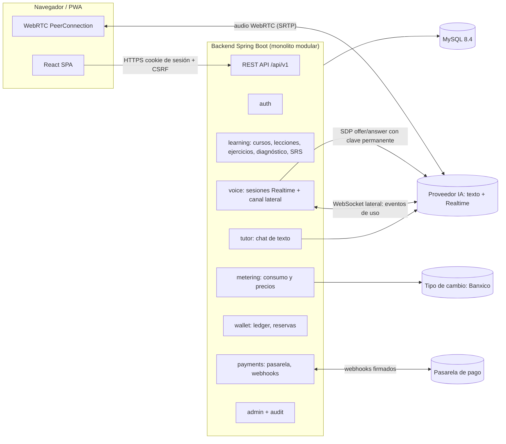

# 2. Arquitectura recomendada

## 2.1 Estilo: monolito modular

Un solo despliegue de backend (Spring Boot) organizado por **módulos de dominio** con dependencias explícitas y verificadas por pruebas de arquitectura (Spring Modulith o ArchUnit). Un frontend SPA (React). Una base MySQL. Sin microservicios: el tamaño del equipo y del tráfico no lo justifica, y la consistencia transaccional de la billetera es mucho más simple en un solo proceso con una sola BD.



Punto clave: **el audio va directo del navegador al proveedor** (baja latencia), pero **la negociación, el control y la medición pasan por el backend**.

## 2.2 Tecnologías y versiones

> Las versiones son las líneas recomendadas al 2026-11. 🔍 Al iniciar la Fase 2 se fijará el **último parche estable** de cada una y se registrará en el `pom.xml`/`package.json`.

### Backend
| Tecnología | Versión | Justificación |
|---|---|---|
| Java | **21 LTS** | LTS con soporte amplio en todas las librerías; *virtual threads* útiles para las conexiones WebSocket laterales. (Java 25 LTS es candidato si todas las dependencias lo soportan — 🔍.) |
| Spring Boot | **4.0.x** | Línea actual; la 3.5 sale de soporte OSS en 2026. 🔍 |
| Spring Security | la incluida | Sesiones con cookie `HttpOnly` + CSRF, RBAC con `@PreAuthorize`. |
| Spring Data JPA / Hibernate | incluidas | CRUD de dominio. Consultas financieras críticas con JPQL explícito y bloqueo. |
| Flyway | 11.x | Migraciones versionadas. |
| Spring Session JDBC | incluida | Sesiones en BD: revocables, sobreviven reinicios. |
| springdoc-openapi | 2.x/3.x compatible con Boot 4 🔍 | Documentación OpenAPI y generación de cliente tipado para el frontend. |
| Bucket4j | 8.x | Rate limiting por usuario/IP. |
| JDK `HttpClient` + `WebSocket` | JDK | Cliente del proveedor de IA sin SDK pesado (adaptador propio, fácil de sustituir). |
| Testcontainers | 1.20+/2.x | Pruebas de integración con MySQL real. |
| JUnit 5 / AssertJ / Mockito | — | Pruebas unitarias. |
| ArchUnit o Spring Modulith | — | Prueba que verifica que los módulos respetan sus fronteras. |

### Frontend
| Tecnología | Versión | Justificación |
|---|---|---|
| React | 19 | Requisito. |
| TypeScript | 5.x (estricto) | Requisito. |
| Vite | 7.x | Arranque y build rápidos; no se necesita SSR (app autenticada). |
| Tailwind CSS | 4.x | Requisito; tokens de diseño vía CSS variables (modo claro/oscuro). |
| Radix UI primitives (vía componentes estilo shadcn/ui copiados al repo) | — | Accesibilidad (foco, ARIA, teclado) sin dependencia cerrada. |
| React Router | 7.x | Rutas y *lazy loading*. |
| TanStack Query | 5.x | Estado del servidor, caché, reintentos. |
| Zustand | 5.x | Estado local mínimo (estado de la llamada). |
| openapi-typescript + openapi-fetch | — | Cliente HTTP **tipado desde el OpenAPI del backend**. |
| React Hook Form + Zod | — | Formularios y validación. |
| Recharts | 2.x/3.x | Gráficas del dashboard. |
| vite-plugin-pwa | — | Service worker y manifest. |
| Vitest + Testing Library + Playwright | — | Unitarias, componentes, E2E. |
| i18next (opcional, Fase 8) | — | UI en español/inglés. |

### Datos e infraestructura
| Tecnología | Versión | Justificación |
|---|---|---|
| MySQL | **8.4 LTS** | Requisito; LTS. `utf8mb4`, InnoDB, `DECIMAL` exacto. |
| Docker / Docker Compose | — | Entorno local reproducible (MySQL, Mailpit, backend, frontend). |
| GitHub Actions | — | CI: build, pruebas, análisis de dependencias. |
| Logs JSON (Logback + logstash encoder) + Micrometer/Actuator | — | Registro estructurado y métricas Prometheus. |
| Mailpit (dev) / proveedor SMTP transaccional (prod 🔍) | — | Verificación de correo y recuperación de contraseña. |

### Proveedores externos
| Servicio | Elección inicial | Notas |
|---|---|---|
| IA de texto | Adaptador `LlmClient`; primera implementación OpenAI (misma cuenta que Realtime). Adaptador alterno posible (p. ej. Anthropic Claude). | 🔍 Modelos y precios vigentes se cargan como datos. |
| Voz en tiempo real | OpenAI Realtime API (WebRTC) mediante adaptador `RealtimeVoiceProvider`. | 🔍 Verificar: endpoint de llamadas con SDP desde servidor, conexión lateral por `call_id`, estructura de `usage` en `response.done`, VAD semántico/servidor, transcripción de entrada. |
| Pagos | Mercado Pago (Checkout Pro) mediante `PaymentGateway`; Stripe como alterno. | 🔍 Verificar requisitos de cuenta, comisiones, OXXO/SPEI, validación de firma `x-signature` de webhooks. |
| Tipo de cambio | Banxico SIE (serie FIX) mediante `FxRateProvider`, con captura manual de respaldo. | 🔍 Verificar token y términos de uso. |

## 2.3 Módulos del backend y fronteras

| Módulo | Responsabilidad | Puede depender de |
|---|---|---|
| `shared` | Tipos comunes: `Money`, `Currency`, `Ids`, errores, reloj, idempotencia. | — |
| `identity` | Registro, login, sesiones, roles/permisos, verificación de correo, perfil, consentimiento, borrado de cuenta. | shared |
| `learning` | Cursos, módulos, lecciones, ejercicios, intentos, evaluación determinista, progreso, dominio. | identity, shared |
| `assessment` | Diagnóstico adaptativo y estimación de nivel por habilidad. | learning, identity |
| `vocabulary` | Tarjetas y algoritmo de repetición espaciada. | identity |
| `recommendation` | Motor de recomendaciones basado en reglas. | learning, assessment, vocabulary |
| `tutor` | Conversación por texto, prompts pedagógicos, memoria de alumno, corrección de respuestas abiertas. | ai, metering, learning |
| `voice` | Ciclo de vida de llamadas Realtime, canal lateral, límites, resúmenes. | ai, metering, wallet |
| `ai` | Puertos (`LlmClient`, `RealtimeVoiceProvider`) + adaptadores del proveedor. **Sin lógica de negocio.** | shared |
| `metering` | Registro de uso, versiones de precios, cálculo de costo, tipo de cambio, factor por rol, conciliación. | shared, identity |
| `wallet` | Ledger de doble partida, saldos, reservas, cargos, límites de gasto. | metering, shared |
| `payments` | Pasarela, órdenes de recarga, webhooks, reembolsos. | wallet |
| `gamification` | XP, rachas, logros, misiones (escucha eventos de dominio). | learning (eventos) |
| `admin` | Endpoints de administración, reportes, configuración. | todos (solo lectura + comandos de servicios) |
| `audit` | Bitácora inmutable de acciones sensibles. | shared |

Comunicación entre módulos: llamadas a **interfaces públicas** del módulo (`*Api`) y **eventos de dominio** (`ApplicationEventPublisher`, con `@TransactionalEventListener`) para efectos secundarios (gamificación, notificaciones). Sin acceso cruzado a repositorios de otro módulo.

Capas internas de cada módulo:

```
module/
  api/          ← interfaz pública del módulo + DTOs
  web/          ← controladores REST
  application/  ← casos de uso / servicios transaccionales
  domain/       ← entidades, value objects, reglas puras (testeables sin Spring)
  infrastructure/ ← repositorios JPA, adaptadores externos
```

## 2.4 Decisiones de seguridad de arquitectura

- **Autenticación:** sesión de servidor con cookie `HttpOnly; Secure; SameSite=Lax` (Spring Session JDBC). Se elige sobre JWT porque permite **revocar** sesiones (suspensión de cuentas, cambio de rol) al instante y evita guardar tokens en `localStorage`. Contraseñas con **Argon2id** (o bcrypt coste ≥12).
- **CSRF:** activado (patrón de token en cookie legible + cabecera `X-XSRF-TOKEN`, soporte SPA de Spring Security).
- **CORS:** en producción el frontend se sirve desde el **mismo origen** (reverse proxy) → CORS cerrado. En desarrollo, solo `http://localhost:5173`.
- **Autorización:** RBAC con permisos finos (`wallet:read:any`, `pricing:write`…) verificados en backend (`@PreAuthorize`) y por **propiedad del recurso** (un alumno solo ve lo suyo).
- **Secretos:** variables de entorno / gestor de secretos; nunca en el repositorio; `gitleaks` en CI.
- **Webhooks:** verificación de firma + re-consulta al proveedor + idempotencia por `provider_event_id`.
- **IA:** límites de tokens por solicitud, tope de gasto por usuario/día/mes y global, moderación de entrada, plantillas de prompt versionadas.
- **Cabeceras:** CSP estricta (permitiendo `connect-src` al proveedor Realtime), HSTS, `Permissions-Policy: microphone=(self)`.

ADRs que documentan estas decisiones: [`docs/adr/`](../adr/).
