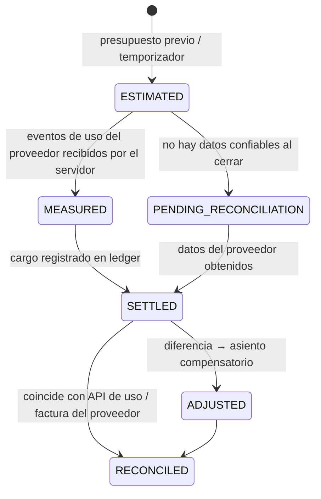

# 5. Reglas de negocio

Identificadores `RN-x`. Las reglas financieras están implementadas como **funciones puras** en `metering/domain` y `wallet/domain`, cubiertas por pruebas unitarias con tablas de casos.

## 5.1 Reglas comerciales y de precio ✅

| ID | Regla |
|---|---|
| RN-1 | **Factor comercial por rol.** `ADMIN` → `1.00` (recargo 0 %). `STUDENT` → `1.30` (recargo 30 % sobre costo). Valores iniciales obligatorios. |
| RN-2 | El 30 % es **markup sobre el costo**, no margen de utilidad neta. |
| RN-3 | El factor solo lo cambia un usuario con permiso `pricing:write`. El cambio crea una **nueva versión** de `commercial_pricing_policies` con `effective_from` ≥ ahora; jamás modifica versiones previas ni cargos liquidados. Queda en auditoría. |
| RN-4 | Cada cargo guarda: factor aplicado, versión de política, versión de tarifa del proveedor, tipo de cambio y su fuente. |
| RN-5 | **Costo base** = solo el costo atribuible de IA del proveedor para esa sesión (tokens/unidades × tarifa vigente). No incluye infraestructura, comisiones ni impuestos. Incluir otros costos requiere aprobación explícita del administrador (cambio de política versionado). |
| RN-6 | El IVA y otros impuestos **no** forman parte del costo base ni del recargo; se calculan aparte según `tax_mode` (ver D-1). Modo inicial en desarrollo: `NONE`. ⚖️ |
| RN-7 | Las comisiones de pasarela las **absorbe el negocio** (D-2) y aparecen en el reporte de utilidad neta. Nunca se añaden como cargo oculto. |
| RN-8 | El consumo del administrador se liquida como **gasto interno** (cuenta `INTERNAL_AI_EXPENSE`), no exige saldo ni pasarela, y se muestra en "Mi consumo". Sigue sujeto a un **tope mensual configurable** para evitar gastos accidentales. |
| RN-9 | Las tarifas del proveedor se cargan como datos versionados (`provider_pricing_versions`) con fuente (URL de la página oficial) y fecha de verificación. 🔍 **Ninguna tarifa se codifica en el código fuente.** |

## 5.2 Cálculo del cargo (algoritmo normativo)

```
Entradas:
  units[k]           cantidades reportadas por el proveedor por tipo k
                     (text_in, text_in_cached, text_out, audio_in, audio_in_cached, audio_out, …)
  rate[k]            USD por 1 000 000 unidades (versión de tarifa vigente al INICIO de la sesión)
  fx                 MXN por 1 USD (tipo de cambio vigente al liquidar; fuente registrada)
  factor             1.00 | 1.30 (política vigente al INICIO de la sesión)
  taxRate            p. ej. 0.16, si tax_mode lo requiere

1. providerCostUsd   = Σ units[k] × rate[k] / 1 000 000            escala 10, sin redondeo intermedio
2. directCostMxnRaw  = providerCostUsd × fx                         escala 10
3. directCostMxn     = round(directCostMxnRaw, 2, HALF_UP)          ← punto financiero
4. priceBeforeTax    = round(directCostMxnRaw × factor, 2, HALF_UP) ← punto financiero
5. markupMxn         = priceBeforeTax − directCostMxn               (exactamente 0.00 si factor = 1.00)
6. taxMxn            = round(priceBeforeTax × taxRate, 2, HALF_UP)   (0 si tax_mode = NONE o rol ADMIN)
7. totalCharge       = priceBeforeTax + taxMxn
```

Ejemplo de referencia (prueba unitaria obligatoria): costo del proveedor $100.00 MXN →
admin: `price = 100.00`, `markup = 0.00`; alumno: `price = 130.00`, `markup = 30.00`.

| ID | Regla de redondeo y precisión |
|---|---|
| RN-10 | Internamente: USD con escala 10, tipos de cambio con escala 6, tarifas con escala 10. |
| RN-11 | Importes monetarios MXN liquidados: 2 decimales, `RoundingMode.HALF_UP`. Solo se redondea en los pasos 3, 4 y 6. |
| RN-12 | Las sesiones de texto se liquidan **por conversación** (cierre explícito o 30 min de inactividad), no por turno, para no redondear fracciones de centavo en cada mensaje. La diferencia de redondeo acumulada se reporta. |
| RN-13 | Moneda de la billetera: MXN. Moneda del proveedor: la que indique su tarifa (normalmente USD). |
| RN-14 | Tipo de cambio: fuente primaria 🔶 Banxico FIX del día hábil anterior; respaldo: último valor válido con antigüedad ≤ 5 días hábiles; si no hay, la sesión queda `PENDING_RECONCILIATION` (no se inventa). |

## 5.3 Estados del consumo



| ID | Regla |
|---|---|
| RN-15 | Una estimación jamás se muestra como costo definitivo: la UI etiqueta "estimado" vs. "medido" vs. "conciliado". |
| RN-16 | Ajustes de conciliación se hacen con **asientos compensatorios**, nunca editando asientos existentes. Ajustes a favor del cliente se aplican automáticamente; ajustes en contra mayores a una tolerancia (🔶 $1.00 MXN o 5 %) requieren aprobación admin. |
| RN-17 | Si no hay suficiente información para un cargo final, la reserva permanece retenida hasta un máximo (🔶 72 h) y luego se libera con el cargo medido parcial o cero, registrando incidencia. |

## 5.4 Billetera y reservas

| ID | Regla |
|---|---|
| RN-18 | La billetera es un **ledger de doble partida**: cada asiento (`ledger_transactions`) tiene ≥ 2 líneas (`ledger_entries`) cuya suma es exactamente 0. El saldo es la suma de líneas de la cuenta; la tabla `wallet_accounts.balance` es una caché actualizada en la misma transacción y verificada por un job. |
| RN-19 | Cuentas: `USER_AVAILABLE:{user}`, `USER_RESERVED:{user}`, `PSP_CLEARING:{gateway}`, `REVENUE_AI_COST_RECOVERY`, `REVENUE_MARKUP`, `TAX_PAYABLE`, `INTERNAL_AI_EXPENSE`, `PROVIDER_COST_ACCRUED`, `REFUNDS_PAYABLE`, `ROUNDING`. |
| RN-20 | Asientos tipo: **Recarga** (PSP_CLEARING → USER_AVAILABLE), **Reserva** (USER_AVAILABLE → USER_RESERVED), **Captura** (USER_RESERVED → REVENUE_AI_COST_RECOVERY + REVENUE_MARKUP + TAX_PAYABLE), **Liberación** (USER_RESERVED → USER_AVAILABLE), **Consumo interno admin** (INTERNAL_AI_EXPENSE → PROVIDER_COST_ACCRUED), **Reembolso** (USER_AVAILABLE → REFUNDS_PAYABLE). |
| RN-21 | Toda operación lleva `idempotency_key` única (p. ej. `topup:{paymentId}`, `reserve:{voiceSessionId}`, `capture:{voiceSessionId}`). Repetir la clave devuelve el resultado original sin crear otro asiento. |
| RN-22 | **Política de reserva de voz:** `reserva = min(disponible, costoEstimado(maxMinutos) × factor × (1+IVA) × 1.20)`. Se exige una reserva mínima equivalente a 🔶 2 minutos. `maxMinutos = min(límiteAdmin, límiteUsuario, minutosQueAlcanzaLaReserva)`. |
| RN-23 | Durante la llamada, el backend corta la sesión cuando el costo medido llega al 🔶 90 % de la reserva o al límite de duración; avisa al alumno 60 s antes. |
| RN-24 | Si el costo medido final supera la reserva, el excedente se captura de `USER_AVAILABLE`; si no alcanza, se permite **sobregiro técnico** hasta 🔶 $10.00 MXN, que bloquea nuevas sesiones de pago hasta recargar. Mayor a ese tope → incidencia administrativa. |
| RN-25 | Una sola llamada de voz activa por usuario; las sesiones de texto pueden coexistir pero cada una tiene su propia reserva pequeña (🔶 $5.00 MXN). |
| RN-26 | Límite de gasto mensual del usuario: si `gastoMes + reservaNueva > límite`, se rechaza con mensaje claro. |
| RN-27 | Alerta de saldo bajo cuando `disponible < umbral` (🔶 $30.00 MXN o configurado por el usuario). |
| RN-28 | El saldo son **créditos de servicio** no transferibles y sin retiro en efectivo, salvo devoluciones según política. ⚖️ |
| RN-29 | Recarga mínima 🔶 $100.00 MXN, máxima 🔶 $2 000.00 MXN por operación (antifraude). |

## 5.5 Pagos

| ID | Regla |
|---|---|
| RN-30 | Un pago se acredita solo si: (1) el webhook tiene firma válida, (2) la consulta servidor-a-servidor del pago devuelve estado aprobado, (3) el monto y la moneda coinciden con la orden, (4) la orden pertenece al usuario y no ha sido acreditada antes. |
| RN-31 | Retornar a la URL de éxito **no** acredita nada: la UI muestra "procesando" hasta que el backend confirme. |
| RN-32 | Cada webhook se almacena (cuerpo crudo + cabeceras relevantes) antes de procesarse; se procesa una vez por `provider_event_id`. |
| RN-33 | Comisión real de la pasarela se registra al conocerse (desde el detalle del pago) para el reporte de utilidad neta. |

## 5.6 Reglas de IA y voz

| ID | Regla |
|---|---|
| RN-34 | Uso válido para facturar solo si proviene del **servidor** (canal lateral, respuesta de API, o API de uso del proveedor). Datos de uso enviados por el cliente se ignoran para cobro (pueden mostrarse como estimación local). |
| RN-35 | Tiempo conectado ≠ consumo facturable; ambos se registran por separado. |
| RN-36 | Desconexión: si no se recibió uso para un intervalo, no se factura ese intervalo; se liquida lo medido. |
| RN-37 | No se almacena audio. Se guarda transcripción solo si el usuario lo permite (activado por defecto para aprendizaje, desactivable), con retención configurable. |
| RN-38 | El modelo nunca decide cobros, permisos ni niveles oficiales; sus salidas estructuradas se validan contra esquema. |
| RN-39 | La retroalimentación de pronunciación basada solo en transcripción se etiqueta "basada en transcripción, no en análisis acústico". |

## 5.7 Reglas académicas

| ID | Regla |
|---|---|
| RN-40 | **Dominio de lección** (configurable): ≥ 80 % de aciertos en ítems deterministas, en ≥ 2 sesiones separadas por ≥ 1 día, con el último intento ≥ 70 %. Estados: `NOT_STARTED → IN_PROGRESS → PRACTICED → MASTERED`; puede volver a `NEEDS_REVIEW` si falla repasos. |
| RN-41 | **Nivel por habilidad**: media móvil exponencial de evidencias ponderadas por dificultad del ítem (nivel MCER del ítem), con contador de evidencias como confianza. |
| RN-42 | **Diagnóstico**: escalera por habilidad, inicio en A2, +1 nivel tras 2 aciertos consecutivos, −1 tras 2 errores; termina con 30 ítems o cuando oscila entre dos niveles 3 veces; nivel = el más alto con ≥ 60 % de aciertos con ≥ 3 ítems. Se informa siempre como **estimado**. |
| RN-43 | **SRS SM-2**: calidad q ∈ 0..5. Si q < 3: repeticiones = 0, intervalo = 1 día. Si no: rep 1 → 1 día, rep 2 → 6 días, luego `intervalo × EF`. `EF' = max(1.3, EF + 0.1 − (5−q)(0.08 + (5−q)·0.02))`. Se guarda `algorithm = 'SM2'` y versión. |
| RN-44 | **XP**: se otorga por actividades completadas y por dominio alcanzado; el XP **no** modifica el nivel MCER. Repetir un ejercicio ya dominado el mismo día otorga XP decreciente. |
| RN-45 | **Racha**: un día cuenta si se completa ≥ 1 actividad significativa (≥ 5 min o 1 lección o 10 repasos). Se permite 1 día de descanso por semana sin romper la racha. Sin castigos por errores. |
