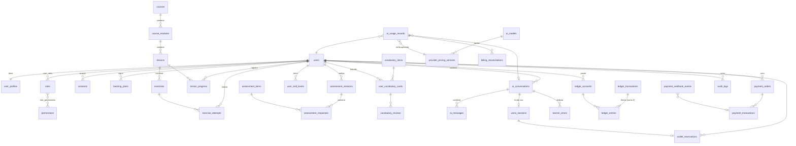

# 6. Modelo de base de datos (MySQL 8.4)

Convenciones:
- Motor InnoDB, `utf8mb4` / `utf8mb4_0900_ai_ci`.
- PK `id BIGINT UNSIGNED AUTO_INCREMENT` internas + `public_id CHAR(26)` (ULID) en entidades expuestas por API, para no filtrar volúmenes ni permitir enumeración.
- Tiempos `DATETIME(6)` en **UTC**. Columnas `created_at`, `updated_at` en tablas mutables; `version INT` para bloqueo optimista donde aplique.
- Dinero MXN: `DECIMAL(19,2)`. Costos de proveedor y cálculos intermedios: `DECIMAL(24,10)`. Tipos de cambio: `DECIMAL(18,6)`. Factores: `DECIMAL(6,4)`.
- Tablas **inmutables** (ledger, auditoría, uso, webhooks): sin `UPDATE` desde la aplicación salvo columnas de estado de procesamiento; el usuario de BD de la app no tiene `DELETE` sobre ellas en producción.
- Enumeraciones como `VARCHAR(32)` + `CHECK` (más fácil de migrar que `ENUM`).

## 6.1 Ajustes respecto a la lista inicial

| Propuesta inicial | Decisión | Motivo |
|---|---|---|
| `user_wallets`, `wallet_ledger_entries` | → `ledger_accounts`, `ledger_transactions`, `ledger_entries` | Doble partida: cuentas de usuario y del negocio en el mismo libro; asiento = cabecera + líneas balanceadas. |
| `ai_session_usage` | → `ai_usage_records` | El uso no solo proviene de sesiones (también de evaluaciones de escritura, resúmenes). |
| `ai_conversations` | se mantiene + `ai_messages` + `voice_sessions` | Los mensajes y las llamadas tienen ciclos de vida distintos. |
| `skill_assessments` | → `assessment_sessions`, `assessment_responses`, `user_skill_levels` | Separar el proceso (diagnóstico) del estado actual (nivel por habilidad). |
| `vocabulary_reviews` | se mantiene + `user_vocabulary_cards` | Catálogo global vs. estado SRS por alumno. |
| `learning_achievements` | → `achievements` (catálogo) + `user_achievements` + `xp_events` + `user_streaks` | |
| `study_sessions` | → `activity_log` | Registro ligero de actividad para tiempo de estudio y rachas. |
| — nuevas | `consents`, `auth_tokens`, `learning_plans`, `learner_errors`, `prompt_templates`, `commercial_pricing_policies`, `fx_rates`, `payment_orders`, `billing_incidents`, `system_settings`, `SPRING_SESSION*` | Justificadas en cada sección. |
| `permissions` | se mantiene, sembrada por migración | Los permisos se definen en código/migraciones; los roles se asignan en BD. |

## 6.2 Diagrama entidad–relación (resumen)

## 6.3 Tablas por módulo

### identity
| Tabla | Campos principales | Claves / restricciones |
|---|---|---|
| `users` | id, public_id, email, email_verified_at, password_hash, status (`ACTIVE`,`SUSPENDED`,`DELETED`), failed_login_count, locked_until, last_login_at, created_at, updated_at, version | UNIQUE(email), UNIQUE(public_id) |
| `user_profiles` | user_id, display_name, explanation_language (`es`,`en`), timezone, daily_goal_minutes, learning_goals JSON (lista cerrada validada), monthly_spend_limit_mxn, low_balance_threshold_mxn, store_transcripts BOOL, onboarding_completed BOOL | PK/FK user_id |
| `roles` | id, code (`ADMIN`,`STUDENT`), description | UNIQUE(code) |
| `permissions` | id, code (p. ej. `pricing:write`) | UNIQUE(code) |
| `user_roles` / `role_permissions` | pares de FK | PK compuesta |
| `consents` | id, user_id, document_type (`TERMS`,`PRIVACY`,`TRANSCRIPTS`), document_version, accepted_at, ip_hash | INDEX(user_id, document_type) |
| `auth_tokens` | id, user_id, purpose (`EMAIL_VERIFY`,`PASSWORD_RESET`), token_hash, expires_at, used_at | UNIQUE(token_hash); solo se guarda el hash |
| `SPRING_SESSION`, `SPRING_SESSION_ATTRIBUTES` | esquema estándar de Spring Session JDBC | |

### learning
| Tabla | Campos principales | Claves / restricciones |
|---|---|---|
| `courses` | id, public_id, slug, title, cefr_level, description, status, sort_order | UNIQUE(slug) |
| `course_modules` | id, course_id, title, objective, sort_order, status | FK course_id; UNIQUE(course_id, sort_order) |
| `lessons` | id, public_id, module_id, slug, title, cefr_level, objective, explanation_md, examples JSON, mastery_rule JSON, review_rule JSON, estimated_minutes, status, content_version, sort_order | FK module_id; UNIQUE(slug) |
| `lesson_prerequisites` | lesson_id, prerequisite_lesson_id | PK compuesta; CHECK distinto |
| `lesson_vocabulary` | lesson_id, vocabulary_item_id | PK compuesta |
| `exercises` | id, public_id, lesson_id (NULL si es de banco), type, skill, cefr_level, difficulty, prompt JSON, solution JSON (**nunca** se serializa al alumno), feedback JSON, status, sort_order | FK lesson_id; INDEX(skill, cefr_level) |
| `exercise_attempts` | id, user_id, exercise_id, lesson_id, answer JSON, is_correct, score DECIMAL(5,4), evaluation_method (`RULE`,`AI`), ai_usage_id, hints_used, duration_ms, idempotency_key, created_at | INDEX(user_id, exercise_id, created_at); UNIQUE(user_id, idempotency_key) |
| `lesson_progress` | user_id, lesson_id, state, best_score, sessions_count, last_attempt_at, mastered_at, next_review_at, version | PK(user_id, lesson_id); INDEX(user_id, next_review_at) |
| `learning_plans` | id, user_id, source (`DIAGNOSTIC`,`MANUAL`), plan JSON (secuencia de módulos), is_active, created_at | INDEX(user_id, is_active) |
| `activity_log` | id, user_id, activity_type, ref_id, minutes, occurred_at, local_date | INDEX(user_id, local_date) |

### assessment
| Tabla | Campos principales | Claves |
|---|---|---|
| `assessment_items` | id, skill, cefr_level, type, prompt JSON, solution JSON, status, discrimination_note | INDEX(skill, cefr_level, status) |
| `assessment_sessions` | id, public_id, user_id, status (`IN_PROGRESS`,`COMPLETED`,`ABANDONED`), algorithm_version, started_at, completed_at, result JSON | INDEX(user_id) |
| `assessment_responses` | id, session_id, item_id, skill, presented_level, answer JSON, is_correct, score, ai_usage_id, created_at | UNIQUE(session_id, item_id) |
| `user_skill_levels` | user_id, skill, estimated_level, score DECIMAL(6,4), confidence, evidence_count, updated_at | PK(user_id, skill) |

### vocabulary
| Tabla | Campos principales | Claves |
|---|---|---|
| `vocabulary_items` | id, term, part_of_speech, ipa, translation_es, contextual_meaning, examples JSON, cefr_level, status | UNIQUE(term, part_of_speech) |
| `user_vocabulary_cards` | id, user_id, vocabulary_item_id, algorithm (`SM2`), algorithm_version, state JSON (ef, repetitions, interval), learning_state, due_at, lapses, last_reviewed_at, version | UNIQUE(user_id, vocabulary_item_id); INDEX(user_id, due_at) |
| `vocabulary_reviews` | id, card_id, quality, reviewed_at, state_before JSON, state_after JSON, duration_ms | INDEX(card_id, reviewed_at) |

### tutor / voice / ai
| Tabla | Campos principales | Claves |
|---|---|---|
| `prompt_templates` | id, code, version, body, created_by, created_at, is_active | UNIQUE(code, version) |
| `ai_conversations` | id, public_id, user_id, channel (`TEXT`,`VOICE`), mode (`FREE`,`GUIDED`,`ROLEPLAY`,…), topic, prompt_template_id, model_id, status, started_at, ended_at, summary JSON | INDEX(user_id, started_at) |
| `ai_messages` | id, conversation_id, role (`USER`,`ASSISTANT`), content (texto o transcripción), created_at | INDEX(conversation_id, id) — sujeta a retención |
| `learner_errors` | id, user_id, conversation_id, original, correction, explanation, category, created_at | INDEX(user_id, category) |
| `voice_sessions` | id, public_id, conversation_id, user_id, provider, provider_call_id, model_id, status (`STARTING`,`ACTIVE`,`ENDING`,`ENDED`,`FAILED`), end_reason, max_duration_s, connected_at, ended_at, connected_seconds, reservation_id, sideband_status | UNIQUE(provider, provider_call_id); INDEX(user_id, status) |
| `ai_models` | id, provider, model_code, modality (`TEXT`,`REALTIME`), is_enabled, display_name, default_limits JSON | UNIQUE(provider, model_code) |
| `provider_pricing_versions` | id, model_id, currency, rates JSON (USD por 1M unidades por tipo), effective_from, effective_to, source_url, verified_at, verified_by | INDEX(model_id, effective_from) |

### metering
| Tabla | Campos principales | Claves |
|---|---|---|
| `ai_usage_records` | id, user_id, role_at_time, conversation_id, voice_session_id, purpose, provider, model_id, provider_request_id/response_id, units JSON, data_source (`PROVIDER_EVENT`,`PROVIDER_RESPONSE`,`USAGE_API`,`ESTIMATE`), pricing_version_id, provider_cost DECIMAL(24,10), provider_currency, occurred_at, idempotency_key | UNIQUE(idempotency_key) p. ej. `openai:resp:{response_id}`; INDEX(user_id, occurred_at) |
| `usage_settlements` | id, user_id, subject_type (`VOICE_SESSION`,`TEXT_CONVERSATION`,`EXERCISE_EVAL`), subject_id, status (estados de §5.3), provider_cost, provider_currency, fx_rate_id, direct_cost_mxn, commercial_policy_id, factor_applied, price_before_tax_mxn, markup_mxn, tax_mxn, total_mxn, ledger_transaction_id, settled_at | UNIQUE(subject_type, subject_id) |
| `commercial_pricing_policies` | id, role_code, factor DECIMAL(6,4), tax_mode, tax_rate, effective_from, created_by, approval_note | INDEX(role_code, effective_from); CHECK factor > 0 |
| `fx_rates` | id, base, quote, rate DECIMAL(18,6), source (`BANXICO_FIX`,`MANUAL`), rate_date, fetched_at | UNIQUE(base, quote, source, rate_date) |
| `billing_reconciliations` | id, period_start, period_end, provider, expected_cost, provider_reported_cost, difference, status, notes, created_by | |
| `billing_incidents` | id, type, severity, ref_type, ref_id, description, status, resolved_by, resolved_at | INDEX(status) |

### wallet
| Tabla | Campos principales | Claves |
|---|---|---|
| `ledger_accounts` | id, code (p. ej. `USER_AVAILABLE`), owner_user_id NULL, currency, balance DECIMAL(19,2) (caché), allow_negative BOOL, version | UNIQUE(code, owner_user_id, currency) |
| `ledger_transactions` | id, public_id, type (`TOPUP`,`RESERVE`,`CAPTURE`,`RELEASE`,`INTERNAL_USAGE`,`ADJUSTMENT`,`REFUND`), idempotency_key, description, ref_type, ref_id, created_by, created_at | UNIQUE(idempotency_key) |
| `ledger_entries` | id, transaction_id, account_id, amount DECIMAL(19,2) (+ débito / − crédito), created_at | INDEX(account_id, id); invariante Σ amount por transacción = 0 (validado en servicio + job) |
| `wallet_reservations` | id, user_id, subject_type, subject_id, amount_reserved, amount_captured, amount_released, status (`ACTIVE`,`CAPTURED`,`RELEASED`,`EXPIRED`), expires_at, version | UNIQUE(subject_type, subject_id); INDEX(status, expires_at) |

### payments
| Tabla | Campos principales | Claves |
|---|---|---|
| `payment_orders` | id, public_id, user_id, gateway, amount_mxn, status (`CREATED`,`PENDING`,`APPROVED`,`REJECTED`,`EXPIRED`,`REFUNDED`), gateway_preference_id, idempotency_key, created_at | UNIQUE(idempotency_key); UNIQUE(gateway, gateway_preference_id) |
| `payment_transactions` | id, order_id, gateway, gateway_payment_id, status, amount, currency, fee_amount, net_amount, raw_status, approved_at, credited_ledger_tx_id | UNIQUE(gateway, gateway_payment_id) |
| `payment_webhook_events` | id, gateway, provider_event_id, signature_valid, headers JSON (sin secretos), payload JSON, received_at, processed_at, processing_status, error | UNIQUE(gateway, provider_event_id) |

### gamification / admin / audit
| Tabla | Campos principales | Claves |
|---|---|---|
| `xp_events` | id, user_id, source_type, source_id, xp, created_at | UNIQUE(user_id, source_type, source_id) (evita doble XP) |
| `user_streaks` | user_id, current_streak, longest_streak, last_active_date, rest_days_used_week, version | PK user_id |
| `achievements` / `user_achievements` | code, title, criteria JSON / user_id, achievement_id, awarded_at | UNIQUE(user_id, achievement_id) |
| `system_settings` | key, value JSON, updated_by, updated_at | PK key (límites, umbrales, pesos del recomendador) |
| `audit_logs` | id, actor_user_id, action, target_type, target_id, before JSON, after JSON, ip_hash, user_agent, trace_id, created_at | INDEX(target_type, target_id); INDEX(actor_user_id, created_at); solo INSERT |

## 6.4 Índices y consultas críticas

- Saldo: `ledger_accounts` por `(code, owner_user_id)` → O(1) con caché; verificación nocturna `SUM(ledger_entries.amount)`.
- Cola de repaso: `user_vocabulary_cards (user_id, due_at)`.
- Consumo del mes: `usage_settlements (user_id, settled_at)` — añadir índice.
- Reservas vencidas: `wallet_reservations (status, expires_at)` para job de expiración.
- Reportes admin: vistas o consultas agregadas por día; materializar en tabla diaria si crece el volumen (post-MVP).

## 6.5 Retención y borrado

| Dato | Retención | Al borrar cuenta |
|---|---|---|
| Audio | No se almacena | — |
| `ai_messages` (transcripciones) | 🔶 180 días o hasta borrado | Eliminado |
| Progreso, intentos, tarjetas | Mientras exista la cuenta | Eliminado o anonimizado |
| Ledger, pagos, uso, liquidaciones | ⚖️ Plazo fiscal (5 años típicamente en México — verificar) | Se conserva, `user` anonimizado (email → hash, nombre eliminado) |
| Auditoría | ⚖️ Plazo definido en política | Se conserva con actor anonimizado |
