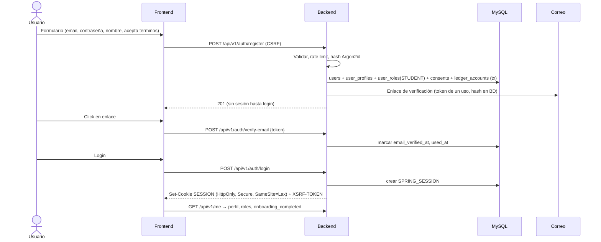

# 7. Flujos críticos

## 7.1 Registro y acceso



**Administrador inicial:** se crea con un comando de arranque (`ADMIN_BOOTSTRAP_EMAIL` + contraseña de un solo uso por variable de entorno) que solo actúa si no existe ningún admin. Nunca hay endpoint público para obtener el rol admin.

## 7.2 Diagnóstico

1. `POST /assessments` crea sesión (`algorithm_version`).
2. Bucle: `GET /assessments/{id}/next` → el servidor elige habilidad y nivel según la escalera (RN-42) y devuelve ítem **sin solución**.
3. `POST /assessments/{id}/responses` → evaluación determinista (o IA con rúbrica para escritura, medida y liquidada) → actualiza estado de la escalera.
4. Fin por regla → `user_skill_levels` + `learning_plans` (módulos del nivel más bajo de habilidades núcleo, priorizando la habilidad más débil) → pantalla de resultados con evidencias y leyenda "no es certificación oficial".

## 7.3 Clase (lección + ejercicios)

1. Dashboard → lección recomendada (motor de reglas).
2. `GET /lessons/{id}` → explicación, ejemplos, vocabulario, ejercicios (sin soluciones).
3. `POST /exercises/{id}/attempts` con `idempotencyKey` → evaluador del tipo → resultado + retroalimentación + solución (ahora sí).
4. Se actualizan `lesson_progress`, `user_skill_levels`, `activity_log`; evento `ExerciseCompleted` → gamificación (XP).
5. Al terminar: resumen, vocabulario nuevo agregado al SRS, siguiente recomendación.

## 7.4 Llamada de voz Realtime (flujo completo con consumo, reserva y cobro)

> 🔍 Los nombres exactos de endpoints, eventos y campos del proveedor se verificarán contra la documentación oficial vigente al implementar la Fase 5. El diseño depende solo de tres capacidades: (1) negociar SDP desde el servidor, (2) recibir eventos de la sesión en el servidor, (3) que esos eventos incluyan uso por respuesta.

```mermaid
sequenceDiagram
  actor U as Alumno
  participant FE as Frontend (WebRTC)
  participant BE as Backend (voice + metering + wallet)
  participant DB as MySQL
  participant AI as Proveedor Realtime

  U->>FE: Abre "Profesor IA" (modo, idioma de explicación)
  FE->>BE: GET /voice/quote?mode=…
  BE-->>FE: modelo, rango costo/min, máx. minutos, saldo, gasto del mes
  U->>FE: Click "Llamar" (gesto → AudioContext + getUserMedia)
  FE->>FE: Crea RTCPeerConnection + data channel + SDP offer
  FE->>BE: POST /voice/sessions {mode, sdpOffer, idempotencyKey}
  BE->>DB: Verifica email, estado, sin llamada activa, límites
  BE->>DB: Reserva (USER_AVAILABLE → USER_RESERVED) [admin: sin reserva, tope interno]
  BE->>AI: Crear llamada: sdpOffer + config de sesión (instrucciones, voz, VAD, transcripción) con clave permanente
  AI-->>BE: sdpAnswer + call_id
  BE->>AI: Abrir WebSocket lateral (call_id) — servidor recibe eventos
  BE->>DB: voice_sessions = ACTIVE
  BE-->>FE: sdpAnswer, sessionId, maxDuration
  FE->>AI: Conexión WebRTC (audio bidireccional directo)
  loop Durante la llamada
    AI-->>BE: response.done {usage} (canal lateral)
    BE->>DB: ai_usage_records (idempotente por response_id)
    BE->>BE: costo acumulado vs. 90% reserva y duración
    BE-->>FE: SSE /voice/sessions/{id}/meter (costo medido, tiempo restante)
    U->>AI: Interrumpe hablando (VAD) → el proveedor cancela respuesta en curso
  end
  alt Usuario cuelga
    FE->>BE: POST /voice/sessions/{id}/end
  else Límite alcanzado
    BE->>AI: Enviar aviso y luego cerrar llamada
  else Desconexión
    BE->>BE: Watchdog: sin eventos/ICE → cerrar tras gracia (🔶 20 s)
  end
  BE->>AI: Cerrar llamada; esperar eventos finales (🔶 ≤ 5 s)
  BE->>DB: usage_settlement: costo → fx → factor → (IVA) → total
  BE->>DB: Captura (USER_RESERVED → ingresos) + Liberación del resto [admin: INTERNAL_AI_EXPENSE]
  BE->>BE: Generar resumen académico (LLM de texto, también medido)
  BE-->>FE: Resumen: duración, consumo (medido), temas, errores, vocabulario, siguientes pasos
```

Reglas aplicadas: RN-21…RN-25, RN-34…RN-37.

**Fallos y casos límite**

| Caso | Comportamiento |
|---|---|
| Falla la creación de la llamada en el proveedor | Liberar reserva (idempotente), `voice_sessions.status = FAILED`, sin cargo. |
| El canal lateral no conecta | No se inicia la llamada (sin medición confiable no se permite consumo de pago). Para admin, configurable. |
| El navegador se cierra sin colgar | Watchdog del backend cierra la llamada y liquida lo medido. |
| Llegan eventos de uso después del cierre | Se registran; si la liquidación ya ocurrió, se genera ajuste compensatorio (RN-16). |
| Reinicio del backend durante llamada | Job de arranque: sesiones `ACTIVE` sin canal → cerrar en proveedor, liquidar lo registrado, marcar `PENDING_RECONCILIATION` si faltan datos. |
| Doble click en "Llamar" | Misma `idempotencyKey` → misma sesión; distinta → 409 (una llamada activa). |

## 7.5 Recarga de saldo

```mermaid
sequenceDiagram
  actor U as Alumno
  participant FE as Frontend
  participant BE as Backend (payments + wallet)
  participant PSP as Pasarela
  U->>FE: Recargar $200
  FE->>BE: POST /payments/orders {amount, idempotencyKey}
  BE->>PSP: Crear preferencia (external_reference = order public_id)
  BE-->>FE: URL de checkout
  FE->>PSP: Redirección, el alumno paga
  PSP-->>FE: Regresa a /wallet?order=… → UI "procesando"
  PSP->>BE: Webhook (firmado)
  BE->>BE: Guardar evento crudo; verificar firma; dedupe provider_event_id
  BE->>PSP: GET pago (servidor-a-servidor)
  BE->>BE: aprobado ∧ monto ∧ moneda ∧ orden correcta ∧ no acreditada
  BE->>BE: Ledger TOPUP (idempotency topup:{gatewayPaymentId})
  FE->>BE: Polling /payments/orders/{id} → APPROVED → saldo actualizado
```

## 7.6 Texto con IA (consumo y cobro)

1. Al abrir conversación de pago: reserva pequeña (RN-25).
2. Cada turno: backend llama al proveedor (streaming), toma `usage` de la respuesta del servidor → `ai_usage_records`.
3. Si el costo acumulado se acerca a la reserva → ampliar reserva (si hay saldo) o pedir cerrar.
4. Cierre (explícito o inactividad 30 min) → liquidación única (RN-12) → captura + liberación.

## 7.7 Conciliación

- Diario (job): sumar `ai_usage_records` por proveedor/modelo/día y compararlo con la API de uso/costos del proveedor (🔍 disponibilidad y granularidad). Diferencias > tolerancia → `billing_incidents`.
- Mensual: comparar con la factura del proveedor (captura manual del admin) → `billing_reconciliations`.
